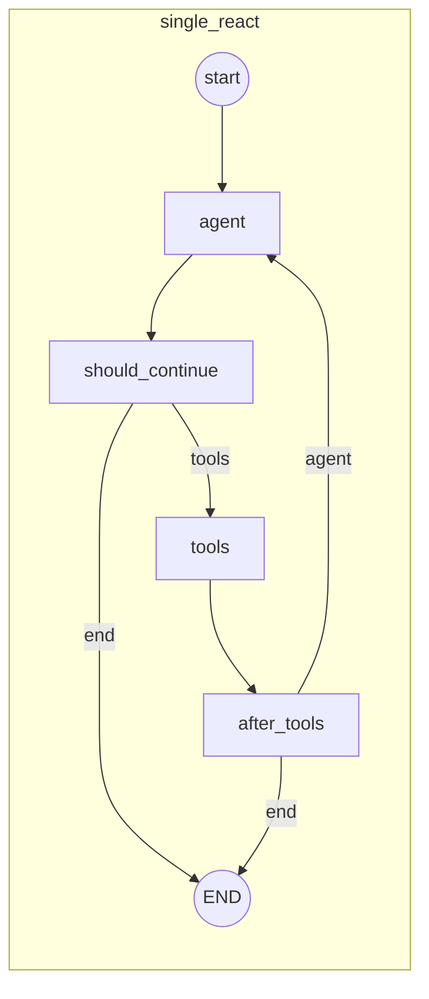
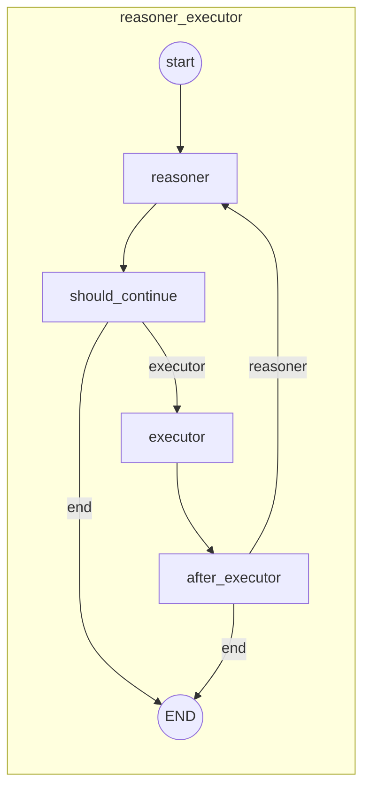
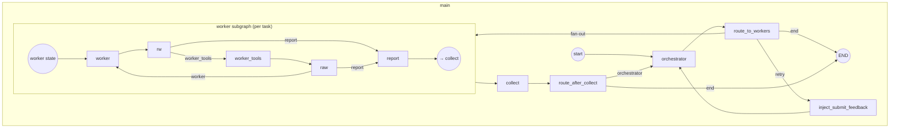
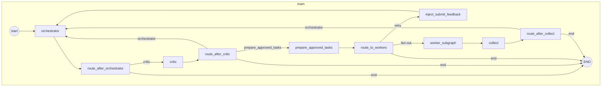

# MaLO LangGraph Workflows

This document describes how each architecture workflow works in `MaLO`, including limits and where they apply.

---

## 1. Configuration and Limits

### 1.1 Global Limits (from `limits` in experiment YAML)

| Limit | Config key | Default | Where applied |
|-------|------------|---------|----------------|
| **Max turns** | `max_turns` | (required) | All graphs: `check_turn_limit()` in routing; one increment per main-loop turn (orchestrator/agent/reasoner turn). |
| **Max cost (USD)** | `max_cost_usd` | (required) | **Not enforced** (see §7). A warning is printed when estimated cost exceeds this limit. |
| **Observation truncation** | `observation_truncation_chars` | (required) | Tool output truncation in `execute_tool_calls()`; worker report truncation. |
| **Assistant output backpressure** | `max_message_chars` | None | Truncates assistant message content stored in state. |
| **Recursion limit** | `recursion_limit` | 100 | Passed to `graph.invoke(..., config={"recursion_limit": N})` to cap LangGraph steps. |
| **Max workers** | `max_workers` | 3 | Orchestrator architectures: max parallel worker subgraphs per round (`valid_tasks[:max_workers]`). |
| **Worker max turns** | `worker_max_turns` | 10 | Orchestrator architectures: per-worker subgraph turn cap. |
| **Per-turn timeout** | `worker_timeout_seconds` | None | Used as a per-node wall‑clock timeout: single_react agent and tools (fatal timeouts), reasoner (fatal), executor (non‑fatal: returns a synthetic result), orchestrator (fatal), critic (non‑fatal: treated as approve), and worker subgraphs (non‑fatal: worker report marked timed out). Tool execution also passes this into `execute_script`. |
| **Challenge timeout** | `challenge_timeout_seconds` | None | Optional overall timeout around `graph.invoke()`; on timeout the run ends with `termination_reason="challenge_timeout"`. |
| **Deterministic seed** | `random_seed` | None | Passed to LLM client for deterministic sampling when supported. |

### 1.2 Termination & Timeout Policy (by node)

This table documents the current termination behavior for each timeout type.

| Node / Timeout Type | Applies In | Behavior on Timeout | termination_reason | Fatal? |
|---|---|---|---|---|
| **Agent LLM timeout** | `single_react` | Stop run immediately | `llm_timeout` | Yes |
| **Tool execution timeout** | `single_react` | Stop run immediately | `tool_timeout` | Yes |
| **Reasoner LLM timeout** | `reasoner_executor` | Stop run immediately | `llm_timeout` | Yes |
| **Executor LLM timeout** | `reasoner_executor` | Return synthetic result and continue | *(none)* | No |
| **Orchestrator LLM timeout** | `orchestrator_workers`, `orchestrator_critic_workers` | Stop run immediately | `llm_timeout` | Yes |
| **Critic LLM timeout** | `orchestrator_critic_workers` | Treat as approve and continue | *(none)* | No |
| **Worker subgraph wall-clock timeout** | `orchestrator_workers`, `orchestrator_critic_workers` | Return timeout report and continue | *(none)* | No |
| **Challenge timeout** | all | Stop run immediately | `challenge_timeout` | Yes |

Notes:
- Tool timeouts inside worker subgraphs terminate that worker task, but do not
  terminate the overall workflow.
- Non-fatal timeouts log warnings and may influence downstream decisions.

### 1.3 Architecture-specific (hardcoded)

| Limit | Value | Where |
|-------|--------|--------|
| **Critic max rejections** | 3 | `MAX_REJECTIONS` in `orchestrator_critic_workers.py`. After 3 consecutive REJECTs, plan is forced APPROVE. |

---

## 2. Single Agent ReAct (`single_react`)

— Standard ReAct loop; single LLM with all tools; baseline.
- **Use case:** Baseline performance.

### 2.1 Flow

1. **agent** — LLM gets messages + system prompt; can output text or tool calls.
2. **Routing:** If tool calls → **tools**; if no tool calls or terminate → **END**.
3. **tools** — Execute tool calls (execute_script, submit_goal, give_up, request_human_help); append tool results to messages.
4. **Routing:** If `done` or turn limit → **END**; else → **agent**.

Turn count increments once per **agent** invocation.

### 2.2 Mermaid

### 2.3 Limits (single_react)

- **max_turns:** Checked in `should_continue` and `after_tools`; stops when `turn_count >= max_turns`.
- **observation_truncation_chars:** Applied in tool node when executing tools.
- **recursion_limit:** Passed to `invoke()`.

---

## 3. Reasoner + Executor (`reasoner_executor`)

— Decoupled chain; Reasoner has no tool access and outputs JSON commands; Executor runs tools.
- **Use case:** Reduces tool hallucination by forcing a thought step.

### 3.1 Flow

1. **reasoner** — LLM receives messages and objective; **no tools**; responds with free text (expected to contain JSON: thought + command).
2. **Routing:** If terminate or turn limit or no parsed command → **END**; else → **executor**.
3. **executor** — Parses `reasoner_command` (bash/python/submit/give_up/error); executes via tool executor (execute_script, submit_goal, give_up); appends result as user message.
4. **Routing:** If `done` → **END**; else → **reasoner**.

Turn count increments once per **reasoner** invocation. Executor does not consume a separate “turn” in `turn_count`.

### 3.2 Mermaid

### 3.3 Limits (reasoner_executor)

- **max_turns:** Checked in `should_continue` and `after_executor`.
- **observation_truncation_chars:** Applied in the tool layer (ToolExecutor passes it to execute_script_tool), so executor node receives truncated output.
- **recursion_limit:** Passed to `invoke()`.

---

## 4. Orchestrator + Workers (`orchestrator_workers`)

— Hierarchical Map-Reduce; Orchestrator uses structured JSON state; workers execute in parallel and report back.
- **Use case:** Strategic planning with parallel task execution.

### 4.1 Flow

1. **orchestrator** — LLM gets `orchestrator_state` (JSON), `worker_report`, and optional `last_submit_feedback`. Has tools: submit_goal, give_up. Outputs JSON: `state_update`, `tasks`. Can call submit_goal/give_up; submit (including via task type "submit" when turn > 1) may set `done` / `last_submit_feedback`.
2. **route_to_workers** — If terminate or turn limit → **END**. If no valid tasks (only submit/error or empty) → **retry** → **inject_submit_feedback** → back to **orchestrator**. Otherwise fan-out: up to **max_workers** tasks sent to **worker_subgraph** (each with its own task).
3. **worker_subgraph** (per task):
   - **worker** — LLM with tools (execute_script, submit_goal, give_up, task_complete); dynamic role from task.
   - **worker_tools** — Execute tool calls; truncate observations.
   - **report** — Build worker report from conversation. Exit when `done` or `worker_turn_count >= worker_max_turns`.
4. **collect** — Aggregate all worker reports into `worker_report`.
5. **route_after_collect** — If terminate or turn limit → **END**; else → **orchestrator**.

One **main-loop** turn = one orchestrator invocation (and one round of parallel workers + collect). `turn_count` increments in the orchestrator node.

### 4.2 Mermaid

### 4.3 Limits (orchestrator_workers)

- **max_turns:** Checked in `route_to_workers` and `route_after_collect` (orchestrator-turn level).
- **max_workers:** `valid_tasks[:max_workers]` when dispatching to worker subgraph.
- **worker_max_turns:** In worker subgraph `route_after_worker_tools_internal`; worker loop exits to report when reached.
- **observation_truncation_chars:** In orchestrator tool execution and in worker `execute_tool_calls` and report compilation.
- **recursion_limit:** Passed to `invoke()` (must be high enough for many steps per round).

---

## 5. Orchestrator + Critic + Workers (`orchestrator_critic_workers`)

- Orchestrator proposes plan; Critic approves/rejects; on approve, workers execute; REJECT loops back to Orchestrator.
- **Use case:** System-2 style review before execution.

### 5.1 Flow

1. **orchestrator** — Same idea as orchestrator_workers: state, worker_report, critic_feedback, last_submit_feedback. Outputs JSON with `proposed_plan` (and optional `state_update`). Can call submit_goal/give_up; those set `done` / `last_submit_feedback`.
2. **route_after_orchestrator** — If terminate or turn limit or no proposed_plan → **END**; else → **critic**.
3. **critic** — LLM gets challenge, findings, worker report, proposed plan. No tools. Returns JSON: `verdict` (APPROVE/REJECT), `feedback`, optional `suggestion`. After **MAX_REJECTIONS** (3) consecutive REJECTs, verdict is forced to APPROVE.
4. **route_after_critic** — If REJECT → **orchestrator**; if APPROVE → **prepare_approved_tasks**; if terminate → **END**.
5. **prepare_approved_tasks** — Fills `current_tasks` from `proposed_plan` (`tasks` or `task`).
6. **route_to_workers** — Same pattern as orchestrator_workers: end / retry (→ **inject_submit_feedback** → **orchestrator**) / fan-out to **worker_subgraph**.
7. **worker_subgraph** — Same as orchestrator_workers (worker → tools → report; worker_max_turns).
8. **collect** → **route_after_collect** → **orchestrator** or **END**.

One main-loop turn = one orchestrator invocation. Critic run does not increment `turn_count` (turn is incremented only in orchestrator node).

### 5.2 Mermaid

### 5.3 Limits (orchestrator_critic_workers)

- **max_turns:** Checked in `route_after_orchestrator`, `route_to_workers`, `route_after_collect`.
- **max_workers:** Same as orchestrator_workers when dispatching tasks.
- **worker_max_turns:** In worker subgraph.
- **MAX_REJECTIONS (3):** In critic node; after 3 REJECTs in a row, verdict becomes APPROVE (not in PRD; documented below as to-do).
- **observation_truncation_chars:** Orchestrator tools, critic context truncation, worker tools and reports.
- **recursion_limit:** Passed to `invoke()`; often set higher (e.g. 2000) due to critic + many worker steps per round.

---

## 6. Termination and Tools

- **submit_goal:** Validates against challenge goal; on success/failure sets `done` and `termination_reason`; can set `last_submit_feedback` on failure (orchestrator architectures).
- **give_up:** Sets `done`, `termination_reason = "give_up"`.
- **task_complete:** Used by workers; sets `termination_reason = "task_complete"` and does not terminate the main graph (worker reports and returns).
- **request_human_help:** Returns output with `needs_human=True`. **Current implementation does not pause the graph or wait for CLI input** (see §7).

---

## 7. Summary Table

| Architecture | Main loop | Turn counted as | Worker turns (if any) | Special limits |
|--------------|-----------|------------------|------------------------|----------------|
| single_react | agent ↔ tools | Per agent call | — | `worker_timeout_seconds` (agent timeout fatal; tool timeout fatal) |
| reasoner_executor | reasoner ↔ executor | Per reasoner call | — | `worker_timeout_seconds` (reasoner timeout fatal; executor timeout non‑fatal) |
| orchestrator_workers | orchestrator ↔ workers ↔ collect | Per orchestrator call | `worker_max_turns` (config) | max_workers, worker subgraph timeout non‑fatal |
| orchestrator_critic_workers | orchestrator ↔ critic ↔ workers ↔ collect | Per orchestrator call | `worker_max_turns` (config) | max_workers, 3 rejections, critic timeout non‑fatal |

All workflows respect **max_turns** (at main-loop level), **observation_truncation_chars** (where tool/output truncation is used), and **recursion_limit** (passed into `graph.invoke()`). **max_cost_usd** is not enforced during the run.
